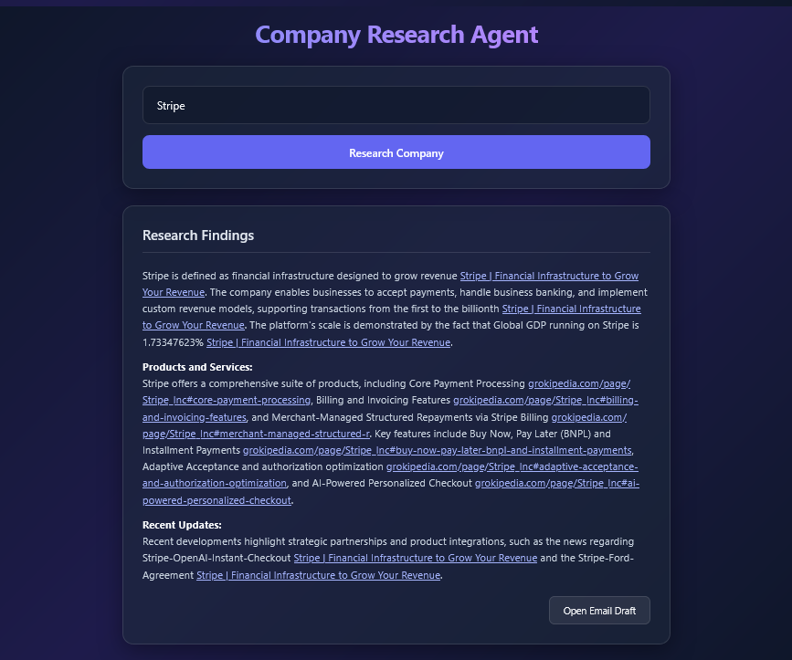
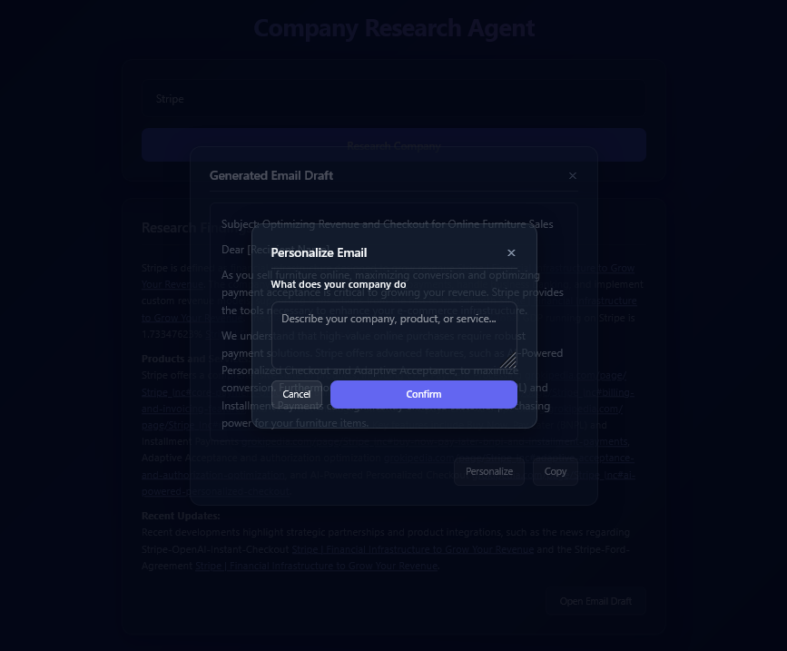
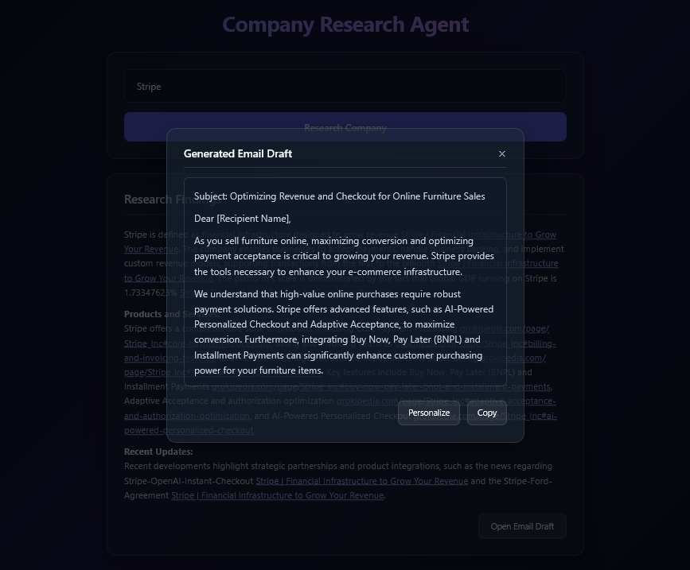

# 🏢 Company Research Agent

## Demo








An autonomous, zero-API local intelligence agent that researches companies from public web data, extracts verified key metrics, generates a structured executive brief with verifiable Markdown citations, and automatically drafts personalized outbound sales copy.

Built as **Day 2** of a production engineering sprint.

---

## How it works
1. Enter a company or industry.
2. The agent crawls public sources.
3. It generates a brief with citations.
4. It drafts a personalized outreach email. 
5. You can presonalize the email draft by putting details about you, your company etc.

---

## ✨ Key Features

* **Zero-API Architecture:** Relies entirely on open-source scraping tools and local model execution—**no paid API keys, no rate limits, and zero external service dependencies**.
* **AI-Native Web Crawling (`Crawl4AI`):** Bypasses heavy anti-bot firewalls and JavaScript-heavy DOM rendering using a headless Chromium browser wrapper, stripping out bloat to output clean, structured Markdown.
* **Local LLM Orchestration (`Ollama`):** Connects to a local instance (e.g., `gemma4` or `llama3`) running locally to synthesize data and ensure strict provenance tracking.
* **Verifiable Markdown Citations:** Automatically attaches source metadata (`Title` and `URL`) to text chunks so the model generates genuine inline links for every factual claim.
* **Modern Glassmorphism Frontend:** A minimal, responsive single-page dashboard featuring a dark mode, glassmorphism UI, a modal for reviewing cold email drafts, and an interactive email personalization tool.

---

## 🛠️ Tech Stack

* **Backend:** FastAPI, Pydantic, Uvicorn
* **Agentic & Scraping Tools:** Crawl4AI, ddgs, BeautifulSoup4
* **AI / Inference:** Local Ollama Server
* **Frontend:** HTML5, CSS3

---

## 📂 Project Structure

```text
company-research-agent/
├── app/
│   ├── src/
│   │   ├── helpers.py      # Core agent logic, Crawl4AI integration, and Ollama wrapper
│   │   └── schemas.py      # Pydantic request/response validation models
│   └── main.py             # FastAPI entrypoint, routing, and JSON post-processing
├── static/
│   └── index.html          # Responsive glassmorphism frontend UI
├── pyproject.toml          # Modern dependency management
└── README.md

```

---

## 🚀 Setup & Installation

### 1. Prerequisites

* **Python 3.10+** installed.
* **Ollama** running locally with your target model loaded (e.g., `ollama run gemma4_e4b_custom`).
* **uv** for quick start.

### 2. Clone and Install Dependencies

Using modern Python packaging (`uv` or standard `pip`):

```bash
# Clone the repository
git clone https://github.com/neonmercenary/company-research-agent.git
cd company-research-agent

# 1. Use uv
uv sync

# or

# 2. Create and activate a virtual environment
python -m venv .venv
source .venv/bin/activate  # On Windows use: .venv\Scripts\activate


# 2.1 Install project dependencies
pip install fastapi uvicorn crawl4ai ddgs beautifulsoup4 pydantic httpx

# 2.2 Initialize Crawl4AI browser binaries
crawl4ai-setup

```

---

## 💻 Running the Application

Start the FastAPI development server with live reload:

```bash
uvicorn app.main:app --port 8000 --reload

```

Open your browser and navigate to:
👉 **`http://localhost:8000`**

---

## 🔌 API Endpoints

* **`GET /`** — Redirects to the static glassmorphism frontend dashboard.
* **`POST /api/v1/search`** — Accepts a company query (e.g., `{"company_details": "Tesla"}`, `{"company_details": "Anthropic"}`), crawls top search results, and returns a JSON payload containing the `brief` (with Markdown citations) and an initial `email_draft`.
* **`POST /api/v1/personalize-email`** — Accepts company context and an existing email draft to rewrite and fine-tune the outbound copy.

---
